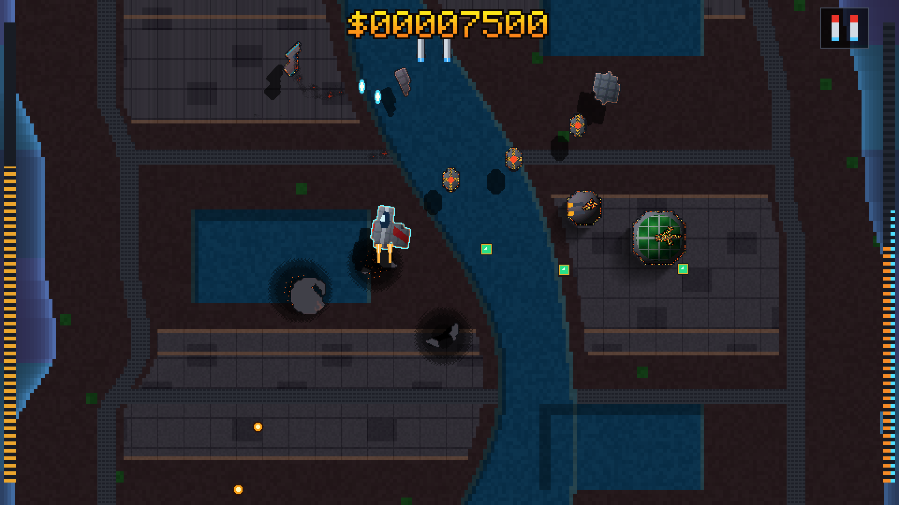

# Dzog Shmup

A vertical wave-stream shoot-'em-up built on the **Dzog** 2D quantum/acoustic wave-matter lattice (`dzog-core`, `dzog-wgpu`, `dzog-bevy`). For deep-dive engineering trade-offs and 2.5D field design insights, see [**`ARCHITECTURE.md`**](./ARCHITECTURE.md).



---

## Core Gameplay & Field-Physics Mechanics

Unlike traditional shmups where ships and buildings are isolated bounding boxes with integer hitpoint counters (`hp: 3`), every actor in **Shmup** is a rotating local material grid (`CohesiveBody`) coupled bidirectionally to a staggered finite-difference wavefield $(p, \mathbf{v}, Q, L)$:

1. **Tri-Lobe Player Interceptor (Topological Hull & Exciton Annealing)**:
   - The player's fighter consists of three physical crystal-titanium structural lobes: **Port Wing**, **Central Core**, and **Starboard Wing**.
   - Heavy impacts physically sever a wing lobe (reducing weapon muzzles and thruster authority) rather than decrementing a health bar.
   - Capturing contested **Annealing Power Canisters** triggers reversible exciton annealing ($\Delta C > 0$), regrowing severed wings from the core outward.
2. **Primary Weapon — Kinetic-Force Projectile Bullets (`[Space]` / `RT`)**:
   - Fires 1–3 parallel high-velocity projectile streams (scaling with intact wings) with forward Doppler amplification.
   - Off-center hits impart punchy linear recoil ($\Delta \mathbf{P} = \mathbf{J}$) and rotational torque ($\Delta L_z = (\mathbf{r} \times \mathbf{J})_z$), physically shoving and spinning enemy craft while carving jagged 1px molten-orange/white-gold fracture veins framed by charred carbon-soot lips.
3. **Progressive Multi-Stage Enemy Fracturing & Non-Overlapping Collisions**:
   - Repeated strikes on existing fractures deepen and branch the cleavage seams until wings or engine nacelles topologically sever via Breadth-First Search (`split_connected_components`).
   - Airborne enemies participate in GPU field force reduction ($-\nabla p, -\nabla Q$) and bump elastically off one another without overlapping—knocking a damaged enemy into a neighbor transfers spin and inflicts sympathetic hull fractures.
4. **Field-Driven Fiery Explosions & Rolling Dark Smoke (`luminescence.wgsl`)**:
   - Impacts and detonations seed multi-lobe thermal kernels into the GPU reaction-diffusion luminescence field $L(\mathbf{x}, t)$. High $L$ renders as white-gold and fiery orange-crimson flames; as $L$ diffuses ($\nabla^2 L$) and cools ($e^{-\gamma_L \Delta t}$), it naturally condenses into billowing dark charcoal smoke clouds.
5. **Alt-Fire — Twin Air-to-Ground Missiles (`[E]` / Gamepad `X`/`LT`)**:
   - Launches finned Air-to-Ground Missiles that fly *beneath* airborne squadrons, home onto ground installations (`GeodesicFuelDome`, `BiodomeReactor`, `FlakTurret`, `CanalPatrolBoat`), and detonate with seismic overpressure (`energy = 2.65`), leaving persistent `ScorchedCrater` pits and `GroundedWreckage` building rubble.
6. **Sympathetic Waveguide Pipeline Chain-Detonations**:
   - Ground fuel domes and biodomes are linked by ribbed `PiezoQuartz` acoustic waveguide pipelines. Detonating a dome injects a guided shockwave along the conduit that sympathetically fractures and detonates connected turrets and reactors, awarding bonus bounty (`$`).
7. **1080p (`16:9`) Sub-Cell VGA Renderer (`148+ FPS`)**:
   - Steps FDTD physics on a `240×135` (`16:9`) lattice while rendering at `4×` sub-cell supersampling (`960×540`), upscaled cleanly via nearest-neighbor to `1920×1080` (1080p) and `3840×2160` (4K) borderless fullscreen displays.

---

## Controls (Keyboard, Mouse & Auto-Detected Gamepad)

Connected gamepads/controllers are detected automatically via Bevy (`bevy_gilrs`) and work simultaneously alongside keyboard and mouse.

| Action | Keyboard / Mouse | Gamepad / Controller |
| :--- | :--- | :--- |
| **4-Way Planar Thrust** | `WASD` or `Arrow Keys` | `Left Stick` or `D-Pad` |
| **Primary: Force Bullets** | `Space` or `Left-Click` | `South (A / Cross)` or `RT / RB` |
| **Alt-Fire: Air-to-Ground Missiles** | `E` or `Middle-Click` | `West (X / Square)`, `East (B)`, or `LT` |
| **Antiphase Shield & Attractor** | `Shift` or `Right-Click` | `North (Y / Triangle)` or `LB` |
| **Toggle Fullscreen / Windowed** | `F11` | — |
| **Toggle Autopilot** | `T` | — |
| **Cycle Perceptual Field Views** | `V` | `Select / Back` |
| **Save / Restore Branch (`Checkpoint`)** | `B` / `U` | — |
| **Pause / Reset** | `P` / `R` | `Start` (Pause) |
| **Quit Game** | `Escape` or `Q` | — |
| **Toggle Binaural Cockpit Audio** | `N` | — |

---

## Quick Start & CLI Options

```bash
# Launch in Borderless Windowed Fullscreen (1080p / 4K auto-upscaled)
cargo run -p shmup

# Launch in 1920x1080 Windowed mode or with Autopilot enabled
cargo run -p shmup -- --windowed
cargo run -p shmup -- --autopilot

# Record a 1920x1080 60 FPS MP4 video with 48 kHz binaural field audio
cargo run --release -p shmup -- --autopilot --record shmup_demo.mp4 --duration 30

# Capture a lossless 1920x1080 PNG screenshot at step 165
cargo run -p shmup -- --screenshot docs/shmup_phase2_5_vga.png

# Run headless WGPU FDTD benchmark & physics validation suite
cargo run -p shmup -- --bench
cargo test -p shmup
```

---

## Module Architecture (`crates/shmup/src/`)

| File | Responsibility |
| :--- | :--- |
| [`field_game.rs`](./src/field_game.rs) | Core `ShmupFieldGame` state (`240×135` 16:9 lattice), FDTD macro-stepping, and zero-readback GPU body reduction. |
| [`canyon.rs`](./src/canyon.rs) | Scrolling ground substrate (`HydroCanal`, `WaveguidePipeline`, `IndustrialPlatform`, `TerraBasalt`, `CanyonWall`). |
| [`spawning.rs`](./src/spawning.rs) | Escalating "Level 2" wave formations (`ChladniMatriarch`, `TwinGunship` pincers, `SectorDreadnought` bosses, and pipeline-linked ground bases). |
| [`combat.rs`](./src/combat.rs) | Kinetic-force bullets, Air-to-Ground Missiles, progressive multi-stage hull fracturing, flying wreckage collisions, and pipeline chain surges. |
| [`render/`](./src/render/mod.rs) | `4×` sub-cell (`960×540`) 1994 VGA renderer, $O(\text{cells})$ horizon shadows, 3D falling wreckage, craters, and HUD gauges. |
| [`gui.rs`](./src/gui.rs) | Bevy borderless fullscreen, 1080p/4K nearest-neighbor scaling, keyboard/mouse/gamepad input, and MP4 recording. |
| [`autopilot.rs`](./src/autopilot.rs) | Autonomous pilot for demos, benchmarks, and video capture. |

---

## Generating Custom Enemies & Ground Buildings (`tools/flux-forge`)

The standalone CLI tool [`tools/flux-forge/flux_forge.py`](../../tools/flux-forge/flux_forge.py) conditions [`black-forest-labs/FLUX.2-klein-4B`](https://huggingface.co/black-forest-labs/FLUX.2-klein-4B) on `CohesiveBody` silhouettes and bakes:
- `*_vga.png`: 5-bit VGA palette-quantized sprite with a 1px dark charcoal keyline.
- `*_height_normal.png`: 4-channel `(nx, ny, nz, elevation_h)` height and surface-normal map for 2.5D horizon shadows and 3D falling-wreckage roof deflection.
- `*_constitutive.json`: Local cohesion seam map (`C_0 = 0.84` along dark armor panel joints) so hulls fracture along their visual seams.

```bash
# Export conditioning masks, VGA sprites, height/normal maps & seam JSONs (no GPU required)
python3 tools/flux-forge/flux_forge.py export-masks --out-dir tools/flux-forge/masks --vga-size 48

# Generate a new enemy ship with FLUX.2 [klein] 4B (4 steps on CUDA)
python3 tools/flux-forge/flux_forge.py generate \
  --entity heavy_bomber \
  --mask tools/flux-forge/masks/twin_gunship_mask.png \
  --prompt "1994 MS-DOS VGA pixel art top-down heavy twin-boom stealth bomber sprite, dark slate armor, dual orange plasma bays, 1px dark keyline, solid black background" \
  --vga-size 48 \
  --out-dir crates/shmup/assets

# Generate a new ground building with automatic height/normal & seam maps
python3 tools/flux-forge/flux_forge.py generate \
  --entity radar_bunker \
  --mask tools/flux-forge/masks/geodesic_dome_mask.png \
  --prompt "1994 MS-DOS VGA pixel art top-down armored concrete radar bunker building, rotating dish, steel rivets, top-left lighting, solid black background" \
  --vga-size 48 \
  --out-dir crates/shmup/assets

# Quantize any existing PNG into a 48x48 VGA sprite + constitutive seam map
python3 tools/flux-forge/flux_forge.py quantize \
  --input my_sprite.png \
  --output crates/shmup/assets/my_sprite_vga.png \
  --vga-size 48
```
