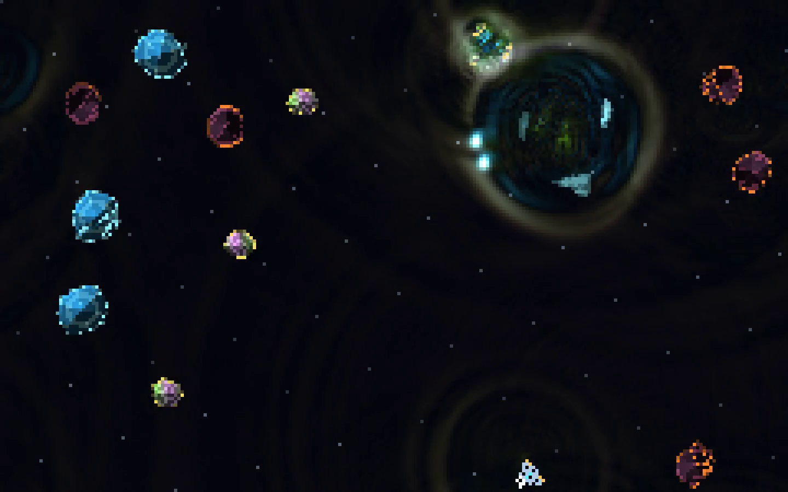

# Dzog

**A GPU-accelerated 2D wave-matter and field-physics engine for Bevy.**

Conventional game engines treat space as an empty coordinate system populated by isolated rigid bodies (`struct Asteroid { hp: 2 }`) that ignore one another until a bounding-box check triggers an imperative callback. **Dzog** replaces object-centric execution with a continuous physical medium governed by wave mechanics, solid-state crystal cohesion, and pilot-wave guidance.

In Dzog, a scene is an **executable physical situation**: a lattice where every cell carries pressure, velocity, material impedance, and structural cohesion. Ships, destructible asteroids, projectiles, and shields are not sealed state machines sitting in dead space—they are persistent patterns of matter and wave excitation that radiate wakes, fracture along continuous stress planes, and interfere across space without collision hierarchies.



---

## Quick Start

```bash
# Run the full verification suite (33 analytical, GPU/CPU agreement, and physics tests)
cargo test --workspace

# Launch the Crystalline Asteroids & Alien Ecology demo (Bevy 0.15 + WGPU + Live Audio)
cargo run -p asteroids

# Launch the Solid-State & Quantum-Vacuum Breakout demo
cargo run -p pong

# Run headless WGPU zero-readback & FDTD benchmarks
cargo run -p asteroids -- --bench
cargo run -p pong -- --bench
```

---

## Theoretical Foundation: Field Mechanics as Computation

Traditional engines model worlds as lists of disconnected bounding boxes: empty space carries no tension or memory, interactions are binary collision events, and adding cross-entity behaviors requires wiring brittle $O(N^2)$ state scripts. Dzog inverts this architecture—**the substrate itself is the computation**. Just as a pixel is a color element and a voxel is a volume element, every cell in a Dzog lattice is a coupled Hamiltonian field element storing dynamic wave state alongside local material commitments (density, stiffness, damping, and cohesion).

Because the medium mediates all causality, complex gameplay mechanics emerge directly from local physical laws rather than scripted special cases. Drawing on nonlinear wave mechanics, David Bohm and Basil Hiley's *active information* (where the spatial curvature of a wavefield guides trajectories), and James Hillman's concept of the *situated image*, every actor continuously perturbs and senses its neighborhood. Weapons fire self-focusing solitary wave packets (solitons); impacts carve internal fracture waveguides that channel stress until crystals cleave topologically into tumbling fragments; shields cancel incoming fire via antiphase destructive interference; and cockpit probes synthesize real-time Doppler audio directly from local pressure oscillations.

### Core Engine Pillars & Why the Math Matters

1. **Constitutive Material Laws over Object Scripts**:
   Every cell evolves under a unified finite-difference time-domain (FDTD) operator parameterized by density $\rho$, bulk modulus $K$, damping $\gamma$, and cohesion $C \in [0, 1]$.
   *Why it matters*: Wave speed, reflection ratios, recoil momentum, and even the musical pitch of an impact emerge automatically from a body's material properties—no per-object interaction scripts required.
2. **Nonlinear Solitary Cohesion (Solitons)**:
   Standard linear waves disperse radially and fade out. Dzog adds a saturating nonlinear self-focusing law that counteracts dispersion while scrubbing low-amplitude background noise.
   *Why it matters*: Plasma bolts, phase-pulses, and balls travel and rebound as crisp, self-sustaining wave packets without rigid-body wrappers or artificial velocity clamping.
3. **Bohm-Hiley Active Information & Pilot-Wave Guidance**:
   The solver continuously evaluates the Bohmian quantum potential $Q$, which measures the *normalized spatial curvature (form)* of the wave envelope rather than raw amplitude.
   *Why it matters*: Subtle standing-wave channels and interference ridges exert an organizing guidance force ($-\nabla Q$) on actors, allowing alien craft to naturally surf phase valleys and weave around shockwaves without pathfinding graphs.
4. **Continuous Cohesion Erosion & Topological Cleaving**:
   Solid structures are regions of high cohesion $C$ with finite yield thresholds. Overpressure erodes cohesion along directional stress axes, opening semi-permeable fracture waveguides before severing the body.
   *Why it matters*: Destruction is topological rather than a hitpoint counter. Striking an existing glowing crack triggers a resonance cleave that splits the crystal via connected-component BFS into independent spinning shards conserving linear and angular momentum.
5. **Counterfactual Situation Branching**:
   Authoring, debugging, and gameplay share a single experimental loop:
   ```text
   Encounter -> Perturb -> Compare -> Commit -> Compose
   ```
   *Why it matters*: Because the entire causal state of the world lives in deterministic lattice buffers, players and authors can snapshot any moment (`[B]`), test a counterfactual action or material change, and restore the branch (`[U]`) with zero state desynchronization.

---

## Numerical Design: Built for Real-Time GPU Execution

Running continuum PDEs at $60\text{–}120\text{ Hz}$ inside an interactive game requires strict numerical discipline so the simulation never explodes into `NaN`s, leaks energy, or stalls the CPU. Full equations, stencils, and proofs are detailed in [**`docs/field_math.md`**](./docs/field_math.md):

- **Yee-Staggered Conservation**: Pressure lives at cell centers and velocity lives on East/North cell faces at half-time steps. This eliminates odd-even checkerboard artifacts and guarantees exact momentum conservation when waves slam into rotating hulls.
- **Exact Fresnel Material Interfaces**: Face densities use adjacent-cell means so high-impedance materials (like `ObsidianAnvil`) naturally reflect glancing shots while piezo crystals (`PiezoQuartz`) transmit fast internal phonons.
- **Blowup-Proof Rational Saturation**: Unlike cubic Kerr nonlinearities that explode when shockwaves collide, Dzog's rational saturation term mathematically bounds peak self-focusing gain while keeping empty vacuum dead-silent.
- **Unconditionally Positive Exponential Damping**: Losses integrate via $\exp(-\gamma \Delta t)$ rather than Euler subtraction, preventing sign-flip instabilities inside high-absorption sponge boundaries and cracked crystal veins.
- **Hamiltonian Energy Harvesting**: The engine tracks instantaneous potential and kinetic field energy across the lattice—directly powering gameplay when the player's Antiphase Shield cancels an enemy wave-bolt ($\Delta \phi = \pi$) and harvests the annihilated wave energy into the ship's weapon capacitor.

---

## Workspace Architecture

| Crate | Role |
| --- | --- |
| [`crates/dzog-core`](./crates/dzog-core) | Reference Yee-staggered FDTD solver, soliton law, Bohmian potential $Q$, Poisson gravity $\Phi_g$, rotating `CohesiveBody` rasterizer & BFS topological cleaving, thruster plumes, antiphase shields, $48\text{ kHz}$ modal audio synthesizer (`FieldModalSynthesizer`), and RON `FieldSpec` / `Checkpoint` serialization. |
| [`crates/dzog-wgpu`](./crates/dzog-wgpu) | GPU compute pipeline (`velocity.wgsl`, `pressure.wgsl`, `impulse.wgsl`, `reduce_body.wgsl`) over ping-pong `RGBA32Float` state textures, toroidal periodic wrapping, zero-readback GPU body force/torque/probe reduction, and verified CPU/GPU agreement ($< 10^{-4}$). |
| [`crates/dzog-bevy`](./crates/dzog-bevy) | Bevy 0.15 engine plugin (`DzogBevyPlugin`): nearest-neighbor field canvas presentation (`FieldImageHandle`), shared perceptual view modes (`FieldViewMode`), WGPU compute accelerator (`GpuFieldAccelerator`), and native `bevy_audio` (`Decodable` / `DzogFieldAudioSource`) streaming. |
| [`asteroids`](./asteroids) | **Field-First Crystalline Asteroids & Alien Ecology**: Free-rotating mineralogical asteroids (`PiezoQuartz`, `ObsidianAnvil`, `BismuthCrystal`), topological cleaving, Bohmian-guided alien saucers & harmonic weavers, reaction thruster backblast, antiphase shield parries, toroidal/gravity-well arenas, and stereo cockpit sonification. |
| [`pong`](./pong) | **Solid-State & Quantum-Vacuum Breakout**: Crystalline phonon coupling, point-of-impact cleavage planes, sympathetic crystal domino cascades, Paddle Doppler Overcharge, coherent Phase-Pulse wave-casting, and counterfactual checkpoint branching. |

### GPU Compute Pipeline (`dzog-wgpu`)

```text
FieldSpec / GPU Impulse Shader (impulse.wgsl)
       |
       v
WGPU Compute Substeps (Pass 1: Velocity + Bohmian Q  -->  Pass 2: Pressure + Soliton Flux)
       |                                                        |
       v                                                        v
Zero-Readback Body Force/Probe Reduction (reduce_body.wgsl)   Bevy Field Canvas & Perceptual Views
       |
       v
48 kHz Modal Synthesizer (FieldModalSynthesizer -> bevy_audio Decodable)
```

| GPU Texture | Format | Packed Channels |
| --- | --- | --- |
| `State A / B` | `RGBA32Float` | `(p_center, vx_east, vy_north, q_bohmian)` |
| `Material` | `RGBA32Float` | `(density_rho, bulk_modulus_K, damping_gamma, cohesion_C)` |
| `Boundary` | `RGBA32Float` | `(wall_east_mask, wall_vx, wall_north_mask, wall_vy)` |

---

## Engineering Boundaries

| Capability | Engineering Boundary |
| --- | --- |
| **GPU stencil parallelism** | $O(\text{cells} \times \text{substeps})$ uniform dispatch work; active vacuum carries potentials across all cells. |
| **Collision-free wave agency** | Wave interference, radiation pressure, and reflection require zero BVH queries, complemented by compact local-grid body contours. |
| **Discrete continuum limits** | Finite-difference lattices remain bounded by declared CFL time steps and Nyquist spatial wavelengths. |
| **Cross-device reproducibility** | Bit-exact within a backend; CPU and GPU floating-point stencils agree within tested tolerances ($< 10^{-4}$). |

---

## Documentation & References

- [**Philosophy (`philosophy.md`)**](./philosophy.md): Relation-first computing, Bohm-Hiley active information, Hillman's situated image, and living actor ecologies.
- [**Field Mathematics (`docs/field_math.md`)**](./docs/field_math.md): Governing PDEs, Yee-staggered stencils, saturating soliton law, Bohmian potential $Q$, and CFL stability bounds.
- [**Runtime Architecture (`docs/ARCHITECTURE.md`)**](./docs/ARCHITECTURE.md): Solitary wave mechanics, moving boundary coupling, and Bevy presentation layer.
- [**Audio Overview (`docs/overview_audio.md`)**](./docs/overview_audio.md): Material-tuned modal synthesis, silent quantum vacuum gating, and `bevy_audio` integration.

---

## License

Permissive **MIT Attribution License** — see [`LICENSE`](./LICENSE). Forks and redistributions must preserve original author credit (`J. Dunlap / jadbox`).
